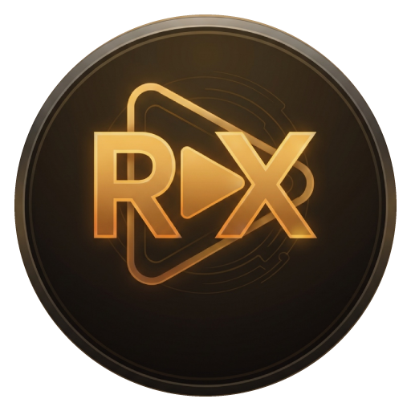

# RX Media Player

[-0078D6?style=flat-square&logo=windows)](https://microsoft.com/windows)
[](https://github.com/jcksprwx/RX-Video-Player/releases/tag/v2.2.0)
[](https://github.com/jcksprwx)
[](LICENSE)
[](https://en.cppreference.com/w/cpp/20)
[](https://learn.microsoft.com/windows/win32/direct3d11/)
[](https://learn.microsoft.com/windows/win32/coreaudio/)
[](https://sqlite.org/)

<p align="center">
  
</p>

**RX Media Player** is a high-performance, production-grade native desktop multimedia player built specifically for 64-bit Windows 10 and Windows 11 by **Rituraj**. Engineered from the ground up in modern **C++20**, it delivers hardware-accelerated Direct3D 11 video presentation, bit-perfect WASAPI audio rendering, an embedded SQLite 3 media library, and an immersive dark-charcoal interface.

---

## 📖 About RX Media Player

**RX Media Player** is a next-generation desktop multimedia player designed and engineered by **Rituraj**. Built specifically for 64-bit Windows 10 and Windows 11, it combines the responsiveness and low footprint of native **C++20** with high-fidelity Direct3D 11 video rendering, studio-grade WASAPI audio processing, and an embedded SQLite 3 media library.

### 🎯 Purpose & Philosophy
Legacy Windows media players are often cluttered with outdated interfaces, sluggish file opening, or unmaintained codecs, while modern alternatives frequently rely on bloated web wrappers (Electron/Chromium) that consume hundreds of megabytes of RAM just to idle.

**RX Media Player** was built with a clear philosophy:
1. **True Native Performance:** Zero web wrappers, zero managed runtime overhead. Written in pure C++20 utilizing direct Win32 and DirectX 11 APIs for sub-second startup times and microsecond seek latency.
2. **Audio-Visual Precision:** Full GPU hardware decoding (D3D11VA and DXVA2) with Direct3D 11 swap chain presentation alongside bit-perfect WASAPI audio with an ISO 10-band equalizer.
3. **Local-First & Privacy Conscious:** All playback history, resume points, and scene bookmarks are stored locally on your machine in an embedded SQLite 3 database. Zero telemetry, zero analytics, zero network tracking.
4. **Cinematic Aesthetic:** A purpose-built dark-charcoal visual theme with warm gold accents, high-DPI scaling, smooth auto-hiding controls, and a distraction-free viewing experience.

### 🏛️ Architecture Overview

| Subsystem | Technology | Purpose & Capabilities |
| :--- | :--- | :--- |
| **Core Architecture** | **ISO C++20** & Win32 API | Native memory safety, instant launch, lightweight ~80 MB idle footprint |
| **Video Engine** | **Direct3D 11** & `libmpv` | Tear-free GPU presentation, D3D11VA/DXVA2 hardware decoding for 4K 60fps & 8K HDR |
| **Audio Engine** | **WASAPI** (Exclusive & Shared) | Low-latency audio streaming, bit-perfect DAC pass-through, dynamic device switching |
| **Audio Processing** | 10-Band Graphic Equalizer | Studio sound shaping (31 Hz – 16 kHz), loudness normalization (`dynaudnorm`), bass & treble controls |
| **Subtitle Engine** | Embedded & External (SRT, ASS, VTT) | Real-time millisecond sync adjustment, custom font rendering, outline & shadow styling |
| **Data Persistence** | **SQLite 3.49** Amalgamation | Local playback resume timestamps, scene bookmarks, watched folders, zero server dependency |
| **Installer & Packaging** | NSIS 3.x & Inno Setup 6 | Clean 34.8 MB standalone installer with Windows Start Menu and desktop shortcuts |

---

## ✨ Features at a Glance

### 🎬 Universal Media Playback & Hardware Acceleration
- **Containers & Formats:** Plays MP4, MKV, MOV, AVI, WMV, WebM, FLV, TS, MP3, FLAC, WAV, AAC, OGG, WMA, and more.
- **Modern Codecs:** Full support for H.264/AVC, H.265/HEVC, AV1, VP8/VP9, MPEG-2, and VC-1.
- **Hardware Decoding:** Automatic Windows hardware decoding via **D3D11VA** and **DXVA2** with graceful software fallback.
- **Ultra HD & High-FPS:** Capable of smooth playback at 1080p, 4K, and 8K resolutions at 60+ FPS.

### 🎨 Picture Adjustments & Real-Time Diagnostics
- **Color Correction:** Real-time Brightness, Contrast, Saturation, Gamma, and Hue adjustment sliders (-100 to +100).
- **Transformations:** Aspect ratio presets (`Auto`, `16:9`, `4:3`, `21:9`), 90°/180°/270° video rotation, horizontal/vertical flipping, and zoom (0.2x to 4.0x).
- **Playback / System Information Window (`Ctrl+I` / `Tab`):** Comprehensive 3-tab technical diagnostics utility inspired by professional Windows diagnostic tools:
  - **Playback Info:** Real-time video/audio decoders, input/output resolutions, pixel formats, bitrates, actual display FPS, scrollable active filter/pipeline list, and animated audio input level meters (FL, FR, C, LFE, SL, SR).
  - **File Info:** Exhaustive metadata inspector displaying container format, byte sizes, durations, video/audio stream properties, subtitle track listings, and embedded ID3/Vorbis/MKV tags with full selection and copy support.
  - **System Info:** Grounded environment telemetry including Windows build number, CPU topology, DirectX 11 GPU adapter enumeration (Dedicated VRAM), active hardware decoder, WASAPI audio device, process memory usage, and dropped frame counters.
  - **Fixed Action Bar:** One-click "Copy to Clipboard" with formatted diagnostic reports and "Always on top" pinning.
- **On-Screen Statistics (`O`):** Hardware-accelerated OSD overlay for real-time performance inspection.

### 🎵 Advanced Audio System & WASAPI
- **WASAPI Endpoint Enumeration:** Queries Windows Core Audio render endpoints and provides dynamic device switching.
- **WASAPI Exclusive Mode:** Bit-perfect audio streaming to external DACs and sound cards.
- **10-Band Graphic Equalizer:** ISO standard center frequencies (31Hz – 16kHz) with gain range from -12dB to +12dB.
- **Studio Presets:** `Flat`, `Rock`, `Pop`, `Jazz`, `Classical`, `Speech / Vocal`, `Bass Boost`, `Treble Boost`, `Movie / Cinema`, and `Custom`.
- **Tone Controls & Volume Normalization:** Independent Bass and Treble sliders, stereo balance adjustment, and optional **EBU R128 loudness normalization** (`dynaudnorm`).

### 💬 Comprehensive Subtitle Management
- **Format Support:** SRT, ASS/SSA, WebVTT, SMI/SAMI, SUB/IDX.
- **Embedded & External Tracks:** Switch between embedded multi-language tracks or load external subtitle files on the fly.
- **Synchronization:** Millisecond-precision subtitle delay slider (-5000ms to +5000ms) with `[` and `]` nudge hotkeys.
- **Visual Styling Customizer:** Choose font family, font size (14–60 pt), text colors, border/outline colors, border width, shadow offset, and vertical bottom margins.

### 🌐 Network Streaming & Remote Media
- **Protocols:** Stream HTTP, HTTPS, HLS (`.m3u8`), DASH (`.mpd`), and RTSP feeds.
- **Open URL Dialog (`Ctrl+U`):** Built-in clipboard detection automatically suggests streams copied from your browser.
- **Buffer & Cache Tuning:** Configurable readahead caching (5s, 15s, 30s, 60s) and memory buffer sizing (50MB, 100MB, 250MB).

### 📚 SQLite 3 Media Library, History & Bookmarks
- **Automatic Resume:** Remembers playback position per file in a persistent local SQLite database (`rx_library.db`) and automatically resumes upon opening.
- **Scene Bookmarks (`Ctrl+B`):** Save timestamps with custom notes. Press `B` to instantly drop a bookmark during playback. Double-click to jump to any saved bookmark.
- **Watched Folders & Library Indexing:** Indexes video/audio files from monitored local drives.

---

## ⌨️ Keyboard Shortcuts Reference

| Shortcut | Action |
|:---|:---|
| **Space** | Play / Pause |
| **Left / Right Arrow** | Seek backward / forward 5 seconds |
| **Up / Down Arrow** | Volume up / down 5% |
| **M** | Mute / Unmute audio |
| **F / F11** | Toggle Borderless Fullscreen mode |
| **Escape** | Exit Fullscreen mode |
| **V** | Toggle Video Picture Adjustments panel |
| **A** | Toggle Audio & Equalizer panel |
| **P** | Toggle Playlist panel |
| **I / Tab** | Open Media Diagnostics dialog |
| **O** | Toggle On-Screen Display (OSD) playback stats |
| **Ctrl + O** | Open File dialog |
| **Ctrl + U** | Open Network Stream / URL dialog |
| **Ctrl + B** | Open Scene Bookmarks dialog |
| **B** | Quick-add bookmark at current position |
| **[ / ]** | Adjust subtitle delay (-100ms / +100ms) |
| **. / ,** | Step one frame forward / backward |
| **S** | Capture high-resolution screenshot to Pictures |

---

## 🛠️ Building from Source

### Prerequisites
- **Operating System:** Windows 10 or Windows 11 (64-bit).
- **Compiler:** GCC / G++ 13+ (e.g. `w64devkit` / MinGW-w64) or Microsoft Visual C++ 2022 with C++20 support.
- **Build System:** [CMake](https://cmake.org/) (version 3.20 or newer) and [Ninja](https://ninja-build.org/).
- **Dependencies:** `libmpv` dev headers and import library (bundled under `third_party/mpv`).

### Build Instructions

1. **Clone the repository:**
   ```bash
   git clone https://github.com/jcksprwx/RX-Video-Player.git
   cd RX-Video-Player
   ```

2. **Download libmpv runtime DLLs:**
   Run the included PowerShell helper script to retrieve `libmpv-2.dll` and `mpv-2.dll`:
   ```powershell
   powershell -ExecutionPolicy Bypass -File "scripts/download_mpv_dlls.ps1"
   ```

3. **Configure with CMake:**
   ```bash
   cmake -B build -S . -G Ninja -DCMAKE_BUILD_TYPE=Release
   ```

4. **Compile the player and automated test runner:**
   ```bash
   ninja -C build rx_player rx_tests
   ```

5. **Run the Automated Test Suite:**
   ```bash
   ./build/rx_tests.exe
   ```

6. **Launch RX Media Player:**
   ```bash
   ./build/rx_player.exe
   ```

---

## 📦 Project Structure

```
RX-Video-Player/
├── CMakeLists.txt              # Primary CMake build definitions
├── README.md                   # Project documentation
├── .gitignore                  # Git ignore rules for build outputs & binaries
├── assets/
│   └── icons/
│       └── rx_logo.svg         # Original RX visual identity vector
├── include/
│   └── rx/
│       ├── api.hpp             # Public API declarations
│       └── types.hpp           # SubtitleStyle, VideoAdjustments, Diagnostics
├── packaging/
│   ├── installer.iss           # Inno Setup 6 64-bit installer script
│   ├── installer.nsi           # NSIS 64-bit modern installer script
│   ├── rx_player.manifest      # High-DPI v2 and OS compatibility manifest
│   ├── rx_player.rc            # Windows resource definitions
│   └── rx_player_rc.o          # Pre-compiled Win32 resource object
├── scripts/
│   └── download_mpv_dlls.ps1   # Helper script to fetch libmpv runtime DLLs
├── src/
│   ├── main.cpp                # High-DPI initialization, WinMain, CLI loader
│   ├── audio/
│   │   ├── equalizer.hpp/.cpp  # 10-band ISO equalizer & filter generator
│   │   └── wasapi_enumerator.hpp/.cpp # IMMDeviceEnumerator Core Audio queries
│   ├── core/
│   │   ├── logger.hpp/.cpp     # Thread-safe log writer
│   │   ├── settings.hpp/.cpp   # INI settings parser and serializer
│   │   └── utils.hpp/.cpp      # Time/byte formatters, UTF-8/Wide conversion
│   ├── engine/
│   │   ├── mpv_backend.hpp/.cpp # Asynchronous libmpv Direct3D 11 wrapper
│   ├── library/
│   │   ├── media_database.hpp/.cpp # SQLite 3 playback history & bookmarks
│   │   └── sqlite/
│   │       ├── sqlite3.h       # SQLite C interface
│   │       └── sqlite3.c       # SQLite 3.49 amalgamation source
│   ├── playlist/
│   │   ├── playlist_item.hpp   # Media item descriptor
│   │   └── playlist_manager.hpp/.cpp # M3U parser, shuffle, repeat state machine
│   └── ui/
│       ├── theme.hpp           # Immersive dark mode & color definitions
│       ├── controls.hpp/.cpp   # Double-buffered RXSeekBar & RXIconButton
│       ├── main_window.hpp/.cpp # Primary Win32 window, autohide control bar
│       ├── dialogs/
│       │   ├── bookmark_dialog.hpp/.cpp # Scene bookmarks manager
│       │   ├── info_dialog.hpp/.cpp     # Diagnostics telemetry dialog
│       │   ├── open_url_dialog.hpp/.cpp # Network streaming dialog
│       │   ├── preferences_dialog.hpp/.cpp # Searchable categorized preferences dialog
│       │   └── sub_dialog.hpp/.cpp      # Subtitle styling customizer dialog
│       └── panels/
│           ├── audio_panel.hpp/.cpp     # Dockable audio & equalizer panel
│           ├── playlist_panel.hpp/.cpp  # Dockable playlist panel
│           └── video_panel.hpp/.cpp     # Dockable picture adjustments panel
├── tests/
│   └── test_core.cpp           # Automated unit test runner
└── third_party/
    └── mpv/
        ├── include/            # mpv C client headers
        └── lib/
            └── libmpv.dll.a    # GCC/MinGW import library
```

---

## ⚖️ License & Acknowledgments

- **Author & Architect:** Designed and engineered by **Rituraj**.
- **RX Media Player** source code is licensed under the MIT License.
- **Multimedia Engine:** Powered by `libmpv` and FFmpeg libraries, dynamically linked under the terms of the GNU Lesser General Public License (LGPL v2.1+).
- **Database Engine:** Embedded SQLite is in the public domain.
